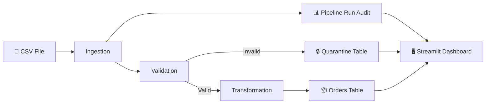

# DataGuard — Data Quality Monitoring & ETL Pipeline Platform

> A complete data engineering project demonstrating CSV ingestion, data validation, PostgreSQL storage, quarantine-based error handling, and a Streamlit monitoring dashboard.

[]()
[]()
[]()

---

## 📋 Table of Contents

- [Overview](#overview)
- [Architecture](#architecture)
- [Technology Stack](#technology-stack)
- [Prerequisites](#prerequisites)
- [Setup Instructions](#setup-instructions)
- [Running the ETL Pipeline](#running-the-etl-pipeline)
- [Launching the Dashboard](#launching-the-dashboard)
- [Running Tests](#running-tests)
- [Data Validation Rules](#data-validation-rules)
- [Sample Data & Expected Results](#sample-data--expected-results)
- [Project Structure](#project-structure)
- [Known Limitations](#known-limitations)
- [Future Improvements](#future-improvements)
- [Troubleshooting](#troubleshooting)

---

## Overview

Business datasets frequently contain duplicate identifiers, missing fields, invalid values, and formatting inconsistencies. Loading such data directly into reporting tables leads to unreliable analytics.

**DataGuard** solves this by providing:
- ✅ **Repeatable ETL** — Ingest CSV files with deterministic validation
- ✅ **Data Quality Rules** — 7 validation rules with clear rejection reasons
- ✅ **Quarantine System** — Rejected records are never silently discarded
- ✅ **Idempotent Loading** — Re-running the same file doesn't create duplicates
- ✅ **Pipeline Auditing** — Every run is tracked with timestamps and counts
- ✅ **Monitoring Dashboard** — Streamlit UI for quality metrics and exploration

---

## Architecture



### Data Flow

1. **Ingestion** — CSV file is read, columns validated, source row numbers assigned
2. **Validation** — Each row is checked against 7 rules; failures accumulate all reasons
3. **Duplicate Detection** — In-batch duplicate `order_id` values are flagged
4. **Transformation** — Valid rows are normalized (trimmed, typed, enriched with `total_amount`)
5. **Persistence** — Valid orders are upserted; rejected records are quarantined with reasons
6. **Audit** — Run metadata (counts, status, timestamps) is recorded
7. **Dashboard** — Streamlit reads from PostgreSQL and displays metrics

---

## Technology Stack

| Component     | Technology           |
| ------------- | -------------------- |
| Language      | Python 3.11+         |
| Database      | PostgreSQL 16        |
| CSV Processing| Pandas               |
| ORM / SQL     | SQLAlchemy + psycopg2|
| Dashboard     | Streamlit + Plotly   |
| Testing       | pytest               |
| Containerization | Docker Compose    |

---

## Prerequisites

- **Python 3.11+** installed
- **Docker & Docker Compose** (for PostgreSQL)
- **Git** (recommended)

---

## Setup Instructions

### 1. Clone and enter the project

```bash
cd DataGuard
```

### 2. Create a virtual environment (recommended)

```bash
python -m venv venv
# Windows:
venv\Scripts\activate
# macOS/Linux:
source venv/bin/activate
```

### 3. Install dependencies

```bash
pip install -r requirements.txt
```

### 4. Configure environment variables

```bash
cp .env.example .env
# Edit .env if you need different database credentials
```

### 5. Start PostgreSQL

```bash
docker-compose up -d
```

### 6. Initialize the database schema

```bash
python scripts/init_db.py
```

---

## Running the ETL Pipeline

```bash
python -m app.pipeline --input data/sample_orders.csv
```

**Expected output:**
```
============================================================
  DATAGUARD PIPELINE RUN SUMMARY
============================================================
              run_id: <uuid>
              status: PARTIAL_SUCCESS
         source_file: sample_orders.csv
       total_records: 26
    accepted_records: 19
    rejected_records: 7
    inserted_records: 19
     updated_records: 0
============================================================
```

### Rerun for idempotency

```bash
python -m app.pipeline --input data/sample_orders.csv
```

The second run will show `updated_records: 19` and `inserted_records: 0` — no duplicates.

---

## Launching the Dashboard

```bash
streamlit run app/dashboard/streamlit_app.py
```

Open [http://localhost:8501](http://localhost:8501) in your browser.

### Dashboard Pages

| Page                | What It Shows                                      |
| ------------------- | -------------------------------------------------- |
| **Overview**        | Run counts, status distribution, accepted/rejected trends |
| **Upload & Ingest** | 📤 **Interactive CSV Uploader**: Drag & drop CSV, pre-ingestion schema check, template download, 1-click execution & real-time results |
| **Pipeline Runs**   | Filterable table of all ETL executions              |
| **Data Quality**    | Accepted vs rejected pie chart, top rejection reasons, quality trend |
| **Quarantine Explorer** | Search & inspect rejected records with reasons  |
| **Orders**          | Valid orders with product breakdown and revenue     |

---

## Running Tests

```bash
# Run all unit tests (no database required)
python -m pytest tests/ -v
```

Tests cover:
- ✅ All 7 validation rules (valid + invalid inputs)
- ✅ Multiple rejection reasons per row
- ✅ Missing/empty/header-only CSV files
- ✅ Missing required columns
- ✅ Duplicate order_id detection
- ✅ Data transformation (whitespace, dates, types, totals)
- ✅ Batch transformation

---

## Data Validation Rules

| # | Field        | Rule                                              |
|---|------------- |---------------------------------------------------|
| 1 | `order_id`   | Required, non-empty string                        |
| 2 | `customer_id`| Required, non-blank                               |
| 3 | `order_date` | Must parse as a valid date (YYYY-MM-DD, MM/DD/YYYY, etc.) |
| 4 | `product`    | Required, non-blank                               |
| 5 | `quantity`   | Integer, greater than zero                        |
| 6 | `unit_price` | Numeric, greater than or equal to zero            |
| 7 | `status`     | Must be PENDING, SHIPPED, DELIVERED, or CANCELLED |

**Additional rules:**
- Duplicate `order_id` within a batch: the **first occurrence** is kept; subsequent duplicates are rejected.
- If `order_id` already exists in the database: the row is **upserted** (updated).

---

## Sample Data & Expected Results

The file `data/sample_orders.csv` contains **26 rows**:

| Row | order_id | Issue                                | Expected |
|-----|----------|--------------------------------------|----------|
| 1-12 | ORD-001 to ORD-012 | Valid records              | ✅ Accepted |
| 13  | ORD-013  | Missing `customer_id`                | ❌ Rejected |
| 14  | ORD-014  | Invalid date `not-a-date`            | ❌ Rejected |
| 15  | ORD-015  | `quantity` is 0                      | ❌ Rejected |
| 16  | ORD-016  | Negative `unit_price`                | ❌ Rejected |
| 17  | ORD-017  | Missing `product`                    | ❌ Rejected |
| 18  | ORD-018  | Non-numeric `quantity` ("abc")       | ❌ Rejected |
| 19  | ORD-019  | Invalid status `REFUNDED`            | ❌ Rejected |
| 20  | ORD-020  | Valid                                | ✅ Accepted |
| 21  | ORD-003  | Duplicate `order_id` (dup of row 3)  | ❌ Rejected |
| 22  | ORD-021  | Valid (has whitespace — gets trimmed) | ✅ Accepted |
| 23-26 | ORD-022 to ORD-025 | Valid records            | ✅ Accepted |

**Expected: 19 accepted, 7 rejected**

---

## Project Structure

```
DataGuard/
├── app/
│   ├── __init__.py          # Package marker
│   ├── __main__.py          # python -m app entry point
│   ├── config.py            # Environment-based configuration
│   ├── logging_config.py    # Structured logging setup
│   ├── pipeline.py          # Main ETL orchestrator + CLI
│   ├── ingestion/
│   │   ├── __init__.py
│   │   └── csv_reader.py    # CSV file reading & column validation
│   ├── quality/
│   │   ├── __init__.py
│   │   ├── rules.py         # Individual validation rule functions
│   │   └── validator.py     # Row-level validator & duplicate detection
│   ├── transformations/
│   │   ├── __init__.py
│   │   └── orders.py        # Data normalization & enrichment
│   ├── storage/
│   │   ├── __init__.py
│   │   ├── database.py      # SQLAlchemy engine & schema init
│   │   ├── repositories.py  # CRUD: runs, orders, quarantine
│   │   └── schema.sql       # PostgreSQL DDL (idempotent)
│   └── dashboard/
│       ├── __init__.py
│       └── streamlit_app.py # Monitoring dashboard (5 pages)
├── data/
│   └── sample_orders.csv    # Synthetic sample data (26 rows)
├── tests/
│   ├── __init__.py
│   ├── test_validation.py   # Validation rule tests
│   ├── test_transformations.py  # Transformation tests
│   └── test_pipeline_logic.py   # Ingestion & flow tests
├── scripts/
│   └── init_db.py           # Database initialization script
├── .env.example             # Environment variable template
├── .gitignore               # Git exclusions
├── docker-compose.yml       # PostgreSQL container
├── requirements.txt         # Python dependencies
├── README.md                # This file
└── PRD.md                   # Product Requirements Document
```

---

## Known Limitations

- **Single-file input**: Processes one CSV at a time (no directory watching)
- **No authentication**: Dashboard has no login/access control
- **No streaming**: Batch processing only (no Kafka/real-time)
- **Local only**: No cloud deployment configuration
- **No incremental processing**: Re-processes the entire file each run
- **Schema changes**: No migration framework (Alembic) — uses idempotent DDL

---

## Future Improvements

- 📅 Apache Airflow DAG for scheduling
- 📤 File upload from dashboard
- 📥 CSV export of rejected records
- 🔧 Configurable validation rules
- ⏰ Data freshness alerts
- 📧 Email/Slack notifications
- 🐳 Full Docker Compose (app + DB)
- #️⃣ Incremental processing via file hash
- 🧪 CI/CD with GitHub Actions

---

## Troubleshooting

### "Connection refused" when running the pipeline
- Ensure PostgreSQL is running: `docker-compose up -d`
- Check `.env` matches your Docker Compose credentials

### "Missing required columns" error
- Verify your CSV has the exact header: `order_id,customer_id,order_date,product,quantity,unit_price,status`

### Dashboard shows "Database query error"
- Run `python scripts/init_db.py` to create tables
- Ensure PostgreSQL is accessible

### Tests fail to import
- Run tests from the project root: `python -m pytest tests/ -v`
- Ensure dependencies are installed: `pip install -r requirements.txt`
